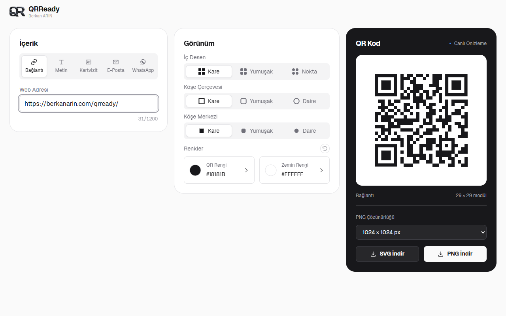

# QRReady


Tek HTML dosyasıyla çalışan, çevrimdışı kullanılabilen QR kod oluşturucu. Kurulum, derleme veya sunucu gerektirmez.

**[Canlı Demo — berkanarin.com/qrready](https://berkanarin.com/qrready/)**



## Özellikler

- Bağlantı, metin, kartvizit, e-posta ve WhatsApp için QR kod oluşturma.
- İç desen, köşe çerçevesi ve köşe merkezini ayrı ayrı özelleştirme.
- Hazır renkler, renk paleti ve HEX koduyla renk seçimi.
- Şeffaf zemin desteği.
- SVG ve 512, 1024, 2048 veya 4096 piksel PNG indirme.
- Kontrast ve yoğunluk uyarıları.
- Aynı sekmede sayfa yenilendiğinde içerik ve seçimleri oturum boyunca koruma.
- Masaüstü ve mobil kullanım; hareket azaltma tercihine uygun animasyonlar.
- Yazı tipleri, imleçler ve QR kod üreticisi dahil gömülü çalışma dosyaları.

## Kullanım

1. Depoyu indirin veya klonlayın:

   ```sh
   git clone https://github.com/berkanarin/QRReady.git
   ```

2. `QRReady.html` dosyasını güncel bir tarayıcıda açın.
3. İçerik türünü seçin ve bilgilerinizi girin.
4. Görünümü düzenleyin. Renk penceresindeki seçimleri **Uygula** ile onaylayın.
5. **SVG İndir** veya **PNG İndir** seçeneğiyle dosyanızı kaydedin.

Yalnızca `QRReady.html` dosyasını paylaşmanız yeterlidir. İnternet bağlantısı veya ek klasör gerekmez.

## Okunabilirlik ve Sınırlar

Metin içeriği **300 UTF-8 bayt** ile sınırlıdır. Diğer içerik türlerinde oluşturulan QR verisi için sınır **1.200 bayttır**. Alanın altındaki sayaç bayt kullanımını gösterir; Türkçe karakterler birden fazla bayt kullanabilir.

Sınır aşılırsa metniniz korunur, QR üretimi ve indirme durur. Yoğun kodlarda içeriği kısaltma veya Kare desen kullanma önerisi gösterilir. Düşük kontrastlı renkleri seçebilirsiniz; uygun kontrast sağlanana kadar QR üretimi durur.

Okunabilirlik; içerik uzunluğuna, desene, renklere, gösterim veya baskı boyutuna ve kameraya bağlıdır. Paylaşmadan önce QR kodunuzu telefonunuzla tarayarak kontrol edin. Şeffaf zemin kullanıyorsanız yerleştireceğiniz yüzeyde de deneyin.

## Gizlilik ve Oturum

QR oluşturma işlemi tarayıcıda yapılır; uygulama girdiğiniz içeriği bir sunucuya göndermez.

Taslaklar, görünüm seçimleri ve PNG çözünürlüğü `sessionStorage` içinde tutulur. Aynı sekmedeki yenilemelerde geri yüklenir. Tarayıcının oturum veya sekme geri yükleme davranışına bağlı olarak kapatılan oturum geri getirilebilir. Tarayıcı depolamayı engellerse uygulama oturum kaydı olmadan çalışır.

## Yayınlama

`QRReady.html` dosyasını sunucuda `qrready/index.html` olarak yayınlayabilirsiniz. Uygulamanın çalışması için başka bir dosya veya arka uç servisi gerekmez.

## Üçüncü Taraf Bileşenler

- [Project Nayuki QR Code Generator](https://www.nayuki.io/page/qr-code-generator-library) — MIT.
- [Geist](https://github.com/vercel/geist-font) — SIL Open Font License 1.1.
- [Bibata Modern Ice](https://github.com/ful1e5/Bibata_Cursor) — GPL-3.0. İmleçler tarayıcı kullanımı için 24 piksele küçültülmüştür; desteklenmeyen ortamlarda sistem imleçleri kullanılır.

Bu bileşenlerin lisans metinleri ve kaynak bilgileri HTML dosyasında korunur.

Berkan ARIN
